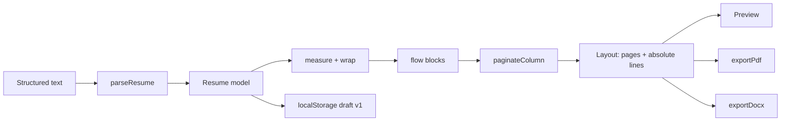

# Architecture

OpenResume is a client-only React application. Its correctness lives in a pure, testable pipeline that runs before anything touches the DOM.

## Invariants

1. **One layout, three consumers.** The preview, PDF, and DOCX all render from the same `Layout` produced by `layoutResume`. No exporter re-computes pagination.
2. **Points are the unit.** Page geometry, typography, and coordinates are expressed in PostScript points. CSS renders the same numbers with `pt` units; jsPDF consumes them directly.
3. **Content is preserved.** The parser never rewrites, summarizes, or normalizes user text beyond structural whitespace. Only explicit edits change content.
4. **Imports replace, never merge.** A new document fully replaces the model; concatenated resumes are rejected.
5. **No hidden I/O.** There are no runtime network calls, no server, and no telemetry. The only persistence is `localStorage`.
6. **Exports contain real text and identical content.** Pages are never rasterized. PDF text is selectable; DOCX paragraphs are editable; both carry every content string.

## Pipeline

## Modules

| Module                   | Responsibility                                       | Must not                     |
| ------------------------ | ---------------------------------------------------- | ---------------------------- |
| `src/lib/parse.ts`       | Deterministic text → `Resume`; warnings, no throwing | Know about React or layout   |
| `src/lib/serialize.ts`   | `Resume` → canonical input text (round-trip)         | Lose information             |
| `src/lib/normalize.ts`   | Upgrade legacy templates and reject invalid presets  | Invent unsupported values    |
| `src/lib/metrics.ts`     | Presets → page geometry, typography, and spacing     | Read the DOM                 |
| `src/lib/measure.ts`     | Helvetica AFM metrics and greedy word wrap           | Depend on the DOM            |
| `src/lib/paginate.ts`    | Flow blocks → pages at line boundaries               | Drop or duplicate lines      |
| `src/lib/layout.ts`      | Build flow blocks, header, page assembly             | Render or export             |
| `src/lib/content.ts`     | Collect every content string for parity checks       | Render or export             |
| `src/lib/exportPdf.ts`   | Draw `Layout` with jsPDF as selectable text          | Recalculate pagination       |
| `src/lib/exportDocx.ts`  | Build a DOCX table per logical page                  | Rasterize or flatten text    |
| `src/lib/storage.ts`     | Versioned, guarded draft persistence                 | Throw on unavailable storage |
| `src/lib/resumeEdits.ts` | Pure immutable edit helpers                          | Mutate inputs                |
| `src/hooks/useDraft.ts`  | Load, debounce-save, reset                           | Hold layout state            |
| `src/App.tsx`            | Wire state, exports, dialogs                         | Contain layout logic         |

## Data model

`Resume` is the single source of truth (`src/types/resume.ts`):

- `header` — name and headline.
- `contact` — email, phone, location, and labeled links.
- `sections[]` — ordered sections with `kind`, `column` (`main`/`side`), `enabled`, and `items[]`.
- `items[]` — title, subtitle, date range, location, body, and bullets.
- `template` — page size, accent, and format settings (margins, font size, line/section/bullet/column spacing, density).

Section IDs and parser-created item IDs are deterministic, so repeated parses of the same text produce deep-equal models.

## Layout and pagination

- Page sizes: US Letter 612 × 792 pt (default), A4 595.28 × 841.89 pt, US Legal 612 × 1008 pt.
- `resolveMetrics()` turns the template into margins, content width, column widths, font sizes, line heights, and spacing, applying the density multiplier on top of individual spacing choices.
- Two independent columns share the content width (about 63% main, a configurable gap, the remainder side). The gap is reduced before the side column can fall below 100 pt.
- The header height is computed from the selected font metrics and the wrapped contact line; both columns start below it on page 1 and at the top margin thereafter.
- Text width is computed from embedded Helvetica AFM widths, which match the PDF's built-in font metrics. Wrapping is deterministic and independent of browser font rendering.
- Every flow block carries a semantic `kind` (`heading`, `title`, `subtitle`, `meta`, `body`, `bullet`, `listItem`, `skillLabel`, `skillValue`) used by the DOCX exporter.
- `paginateColumn` places atomic blocks whole, splits paragraphs and bullet runs at line boundaries, and honours `keepWithNext` for headings, titles, subtitles, and metadata. A heading keeps with the first two lines of the next block.
- Page count is `max(mainPages, sidePages)`. Fully blank and trailing blank pages are removed.

## Exports

**PDF.** jsPDF in `pt` units using the layout's page dimensions, Helvetica normal/bold, no compression, real text runs at the computed baselines. Page count always equals `Layout.pages.length`.

**DOCX.** The `docx` package builds one no-border, three-column table per logical page (main, gap, side). Each flow block becomes one paragraph, so wrapped lines are rejoined and Word handles wrapping naturally. Bullets use Word numbering; headings, titles, and metadata use `keepNext`/`keepLines`; spacing derives from the same metrics. Page size, margins, and table widths follow the selected settings. Text remains editable, though Word may re-flow within a page after edits.

Both exporters are loaded with dynamic `import()` so the initial bundle stays small.

## Content integrity

- The import dialog starts empty; pasting a new resume cannot append to the previous one.
- `parseResume` returns `documentCount`. Text with more than one top-level `#` heading is rejected by the dialog before it can replace the document.
- Applying an import replaces the whole model and preserves only the current template (page size and formatting).
- `collectContentStrings()` extracts every field from the model and is used to assert PDF/DOCX parity.

## State and persistence

- `useDraft` initializes from `loadDraft()` or the sample resume.
- Saves are debounced by 400 ms and flushed on `visibilitychange`.
- Storage is versioned (`openresume:draft.v1`) and structurally validated with `isResume`. Corrupt payloads fall back to the sample; legacy templates are normalized with defaults.
- Formatting lives in `Resume.template`, so it persists with the draft and survives imports.
- `clearDraft()` runs before resetting to the sample; the current template is preserved.

## Dependency policy

Runtime dependencies are limited to:

- `react`, `react-dom` — UI.
- `jspdf` — text-based PDF generation.
- `docx` — editable document generation.

No state library, router, CSS framework, parser library, or storage wrapper. Add a dependency only when it removes more code than it introduces and does not compromise the invariants above.

## Testing

- Parser, serializer, measurement, pagination, layout, edits, storage, and exports have focused unit tests.
- The long-resume test asserts every bullet appears exactly once across pages.
- Export tests assert `%PDF`, page count, real text presence, ZIP magic bytes, and text inclusion.
- Component tests cover editing, section toggling, import, adding sections, and persistence.

## Extension points

- **Page size.** Add a `pageSize` branch in `tokens.ts` and pass dimensions through `layoutResume`.
- **Templates.** Introduce a template profile that supplies tokens, column ratios, and section defaults; do not fork the pipeline.
- **Fonts.** Replace the embedded width tables with a font that is embedded in both the browser and the PDF, keeping measurement and rendering identical.

## Non-goals for v0.1.1

Multi-user accounts, cloud sync, AI generation, PDF/DOCX import, cover letters, and multi-template galleries.
