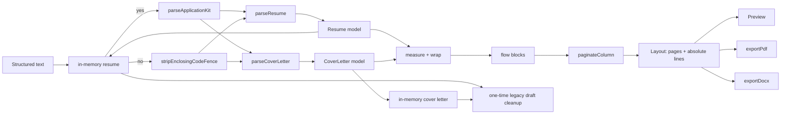

# Architecture

OpenResume is a client-only React application. Its correctness lives in a pure, testable pipeline that runs before anything touches the DOM.

## Invariants

1. **One layout, three consumers.** The preview, PDF, and DOCX all render from the same `Layout` produced by `layoutResume` or `layoutCoverLetter`. No exporter re-computes pagination.
2. **Points are the unit.** Page geometry, typography, and coordinates are expressed in PostScript points. CSS renders the same numbers with `pt` units; jsPDF consumes them directly.
3. **Content is preserved.** Both parsers never rewrite, summarize, or normalize user text beyond structural whitespace. One complete enclosing code fence is treated as a delivery container and removed before parsing; the interior is preserved exactly. Only explicit edits change content.
4. **Preparation replaces, never merges.** A new document fully replaces that document's model; concatenated documents are rejected.
5. **Document-selection first, never fabricated.** The landing page lets the user choose a resume or cover letter. Build always opens preparation; documents from the current session are reached only through their Open action. No sample document is invented.
6. **No hidden I/O.** There are no runtime network calls, no server, and no telemetry. Documents live in memory; the only persistence is the interface theme preference.
7. **Exports contain real text and identical content.** Pages are never rasterized. PDF text is selectable; DOCX paragraphs are editable; both carry every content string.
8. **Interface theme never touches the document.** Light/dark tokens style the shell only. The resume and cover letter pages and exports keep fixed colors.
9. **Independent session documents.** Resume and cover letter models are separate in-memory state and can use different formatting. Building one never changes the other.
10. **AI instructions cannot drift.** Templates are generated from parser constants and tested against every alias.
11. **Public pages do not reload the builder.** Internal information-page navigation uses the History API, so both session documents survive. Direct loads use static HTML shells with page-specific metadata.
12. **The Application Kit is orchestration, not a third copy.** It splits one delimited input into the two existing parsers and reuses the same `resume` and `coverLetter` models, editors, layouts, and exporters. A kit build validates both sections before replacing either model, and failed validation leaves both previous documents untouched.

## Pipeline

## Modules

| Module                                     | Responsibility                                        | Must not                          |
| ------------------------------------------ | ----------------------------------------------------- | --------------------------------- |
| `src/components/LandingPage.tsx`           | Document selection and session Open actions           | Own document state                |
| `src/components/ToastRegion.tsx`           | Dismissible success and error notifications           | Hold document state               |
| `src/components/InfoPages.tsx`             | About, Privacy, and Terms content                     | Own application state             |
| `src/components/InternalLink.tsx`          | History-based internal navigation without reloads     | Bypass the app router             |
| `src/lib/publicPages.ts`                   | Path resolution, page metadata, and history push      | Persist documents                 |
| `src/components/PrepareScreen.tsx`         | Shared preparation, validation, AI copy, examples     | Parse with a wrong parser         |
| `src/components/Header.tsx`                | Brand, context actions, status, theme slot            | Own document state                |
| `src/components/ThemeProvider.tsx`         | Resolve and persist light/dark theme                  | Affect document colors            |
| `src/lib/theme.ts`                         | Theme context, key, and system detection              | Render UI                         |
| `src/lib/themeAssets.ts`                   | Reversed light/dark header and favicon mapping        | Alter generated artwork           |
| `src/lib/tokens.ts`                        | Document accent palette and fixed neutral colors      | Read UI theme tokens              |
| `src/components/Footer.tsx`                | Kovina attribution, links, and version                | Invent branding                   |
| `src/lib/appMeta.ts`                       | Build-time application version                        | Read the network                  |
| `src/lib/codeFence.ts`                     | Strip one complete enclosing fence; preserve interior | Touch ambiguous or partial fences |
| `src/lib/applicationKitFormat.ts`          | Shared Application Kit delimiter constants            | Parse or render                   |
| `src/lib/parseApplicationKit.ts`           | Split one delimited input into two existing parses    | Duplicate parser rules            |
| `src/components/ApplicationKitToolbar.tsx` | Kit tabs and combined/separate export actions         | Own document state                |
| `src/lib/parse.ts`                         | Deterministic text → `Resume`; warnings, no throwing  | Know about React or layout        |
| `src/lib/parseCoverLetter.ts`              | Deterministic text → `CoverLetter`; warnings          | Know about React or layout        |
| `src/lib/aiInstructions.ts`                | Parser-generated AI instruction templates             | Duplicate parser rules            |
| `src/lib/coverLetterLayout.ts`             | Single-column letter layout and pagination            | Recalculate resume layout         |
| `src/lib/coverLetterEdits.ts`              | Pure cover letter edit helpers                        | Mutate inputs                     |
| `src/lib/coverLetterScaffold.ts`           | Reuse resume identity in a letter scaffold            | Generate letter body content      |
| `src/lib/serialize.ts`                     | `Resume` → canonical input text (round-trip)          | Lose information                  |
| `src/lib/normalize.ts`                     | Upgrade legacy templates and reject invalid presets   | Invent unsupported values         |
| `src/lib/metrics.ts`                       | Presets → page geometry, typography, and spacing      | Read the DOM                      |
| `src/lib/measure.ts`                       | Helvetica AFM metrics and greedy word wrap            | Depend on the DOM                 |
| `src/lib/paginate.ts`                      | Flow blocks → pages at line boundaries                | Drop or duplicate lines           |
| `src/lib/layout.ts`                        | Resume flow blocks, header, page assembly             | Render or export                  |
| `src/lib/content.ts`                       | Content strings for resume and letter parity checks   | Render or export                  |
| `src/lib/exportPdf.ts`                     | Draw either `Layout` with jsPDF as selectable text    | Recalculate pagination            |
| `src/lib/exportDocx.ts`                    | Resume tables and single-column letter documents      | Rasterize or flatten text         |
| `src/lib/storage.ts`                       | Validate and remove identified legacy draft entries   | Touch unrelated storage           |
| `src/lib/resumeEdits.ts`                   | Pure immutable resume edit helpers                    | Mutate inputs                     |
| `src/App.tsx`                              | Builder view, public-page route, and both documents   | Contain layout logic              |

## Data model

`Resume` is the single source of truth (`src/types/resume.ts`):

- `header` — name and headline.
- `contact` — email, phone, location, and labeled links.
- `sections[]` — ordered sections with `kind`, `column` (`main`/`side`), `enabled`, and `items[]`.
- `items[]` — title, subtitle, date range, location, body, and bullets.
- `template` — page size, accent, and format settings (margins, font size, line/section/bullet/column spacing, density).

Section IDs and parser-created item IDs are deterministic, so repeated parses of the same text produce deep-equal models.

`CoverLetter` is the second document model (`src/types/coverLetter.ts`):

- `applicant` — name, optional headline, and contact.
- `date`, `recipient[]`, `position`, `salutation`, `closing`, `signature` — optional letter fields.
- `body[]` — ordered body paragraphs.
- `template` — the same page size, accent, and format shape as the resume.

Both models share `Contact`, `ResumeTemplate`, and `FormatSettings`, but have separate parsers, layouts, editors, and in-memory state.

## Layout and pagination

- Page sizes: US Letter 612 × 792 pt (default), A4 595.28 × 841.89 pt, US Legal 612 × 1008 pt.
- `resolveMetrics()` turns the template into margins, content width, column widths, font sizes, line heights, and spacing, applying the density multiplier on top of individual spacing choices.
- Two independent columns share the content width (about 63% main, a configurable gap, the remainder side). The gap is reduced before the side column can fall below 100 pt.
- The header height is computed from the selected font metrics and the wrapped contact line; both columns start below it on page 1 and at the top margin thereafter.
- Text width is computed from embedded Helvetica AFM widths, which match the PDF's built-in font metrics. Wrapping is deterministic and independent of browser font rendering.
- Every flow block carries a semantic `kind` (`heading`, `title`, `subtitle`, `meta`, `body`, `bullet`, `listItem`, `skillLabel`, `skillValue`, plus `letterDate`, `recipient`, `subject`, `salutation`, `letterBody`, `closing`, `signature`) used by the DOCX exporter.
- `paginateColumn` places atomic blocks whole, splits paragraphs and bullet runs at line boundaries, and honours `keepWithNext` for headings, titles, subtitles, and metadata. A heading keeps with the first two lines of the next block.
- Page count is `max(mainPages, sidePages)`. Fully blank and trailing blank pages are removed.
- Cover letters use one full-width column. The letterhead is shared with the resume; blocks are date, recipient lines, subject, salutation, body paragraphs, closing, and signature. Closing keeps with signature, and salutation keeps with the first body paragraph. Empty optional blocks are skipped.
- The document accent comes from `template.accent` (one of the nine palette values). It colors the header name, header rule, and resume section headings. `Layout.accent` carries the value to both exporters; the preview and PDF also read the accent directly from the absolute line/rule colors.

## Exports

**PDF.** jsPDF in `pt` units using the layout's page dimensions, Helvetica normal/bold, no compression, real text runs at the computed baselines. Page count always equals `Layout.pages.length`.

**DOCX.** For resumes, the `docx` package builds one no-border, three-column table per logical page (main, gap, side). For cover letters, it builds one full-width paragraph flow per logical page. Each flow block becomes one paragraph, so wrapped lines are rejoined and Word handles wrapping naturally. Bullets use Word numbering (resume only); headings, titles, metadata, letter closing/signature, and salutation use `keepNext`/`keepLines`; spacing derives from the same metrics. Page size, margins, and table widths follow the selected settings. Heading colors come from the layout lines, and the header name uses `Layout.accent`, so PDF and DOCX share one semantic accent. Text remains editable, though Word may re-flow within a page after edits.

Both exporters are loaded with dynamic `import()` so the initial bundle stays small.

## Content integrity

- Preparation surfaces start empty; a new document cannot append to the previous one.
- `parseResume` and `parseCoverLetter` return `documentCount`. Text with more than one top-level `#` heading is rejected before it can replace the document.
- Building replaces only the selected document's model and preserves its current template (page size and formatting). The other document is untouched.
- Building replaces the previous document of that type in memory without a confirmation dialog.
- `collectContentStrings()` and `collectCoverLetterContentStrings()` extract every field from their models and are used to assert PDF/DOCX parity.
- Both parsers remove one complete enclosing code fence before reading markers; ambiguous, partial, or prose-wrapped fences are left untouched.
- `parseApplicationKit` removes one enclosing fence, requires the two delimiters exactly once in resume-then-letter order, requires non-empty sections and names, and requires a cover letter body. It reports cross-document name and contact differences as warnings without rewriting either model.
- A kit build calls both parsers first and only then replaces the two models, preserving each model's existing template when one is present.
- The AI instruction templates are generated from parser alias constants, require exactly one plain-text code block, and are covered by drift tests.

## Views and workflow

`App` owns a three-value builder view, a prepare kind, a workspace mode, an active document kind, and an optional public-page route:

| View        | When                                   | Content                                                      |
| ----------- | -------------------------------------- | ------------------------------------------------------------ |
| `landing`   | App start, Home, or no active document | `LandingPage` with Resume, Cover Letter, and Application Kit |
| `prepare`   | New, replacement, or first build       | `PrepareScreen` for the prepare kind                         |
| `workspace` | A session document exists              | The active document editor and preview; kit tabs in kit mode |

`prepareKind` is `resume`, `coverLetter`, or `applicationKit`. `workspaceMode` is `single` or `kit`; kit mode renders the Application Kit toolbar and tabs but still uses the same two document models. Building a standalone document returns to single mode; building or opening a kit returns to kit mode.

The pathname `/about`, `/privacy`, or `/terms` renders `InfoPages` inside the same header, footer, and theme provider instead of the builder view. The builder view and both documents stay mounted in React state while a public page is open. Internal links use `history.pushState` and a synthetic `popstate`; browser Back and Forward use the same listener. A full reload is never used for internal navigation, so session documents survive. Each public path has a static Vite HTML shell with page-specific metadata and a direct URL; Vercel `cleanUrls` exposes the extensionless paths.

- `App` owns nullable resume and cover letter state initialized to `null`; neither fabricates a sample.
- The landing card's primary action always opens preparation, with or without a session document.
- A separate Open action opens an existing workspace and is rendered only while that document exists in memory.
- `PrepareScreen` requires exactly one top-level `#` heading and validates the selected parser's required fields. Zero or multiple headings produce a clear error and no state change. The kit variant validates both sections and shows every combined-parser error inline.
- A successful build replaces that model, preserves its template (or reuses the resume template for a first cover letter), and switches to the workspace.
- A successful kit build replaces both models together, preserving each existing template, sets `kitBuilt`, and opens the kit workspace on the Resume tab. A failed kit build changes no document state.
- New returns to preparation without changing the in-memory document; Back returns to the previous workspace or landing.
- The header hides document actions outside the workspace, showing only branding and the theme toggle.
- A matching-letter flow opens cover letter preparation with resume identity/contact prefilled and a return path to the resume. The resume is never modified.

## Theming

- `data-theme="light|dark"` on `<html>`; `color-scheme` follows it.
- Key `openresume-theme` stores an explicit choice.
- With no stored choice, the system preference is used and live `prefers-color-scheme` changes apply.
- An inline script in `index.html` resolves the theme before the stylesheet loads, preventing a flash.
- Tokens in `src/styles/tokens.css` follow the OpenPalette naming convention (`--bg-base`, `--bg-surface`, `--text-primary`, `--border-default`, `--accent`).
- The resume and cover letter pages, PDF, and DOCX use fixed neutral colors plus the document's chosen accent; they are never derived from UI theme tokens.
- Header icons are inline SVGs in `Icon.tsx`, avoiding a new runtime dependency.
- The pre-hydration script and `ThemeProvider` also switch the theme-color metadata and light/dark favicon links; `Header` selects the matching app mark.
- App icons and social assets are generated from the two authoritative PNG masters in `assets/branding/source-assets/` by `scripts/generate-icons.py`; generated files are never hand-edited. The runtime loads only same-origin PNGs.

## State and persistence

- `App` holds `Resume | null` and `CoverLetter | null` in React state. Both survive navigation within the mounted application and disappear when it unmounts or the page reloads.
- No document content is written to `localStorage`, `sessionStorage`, or IndexedDB.
- Formatting lives in each document's `template`, so it stays with that document for the session and survives replacement builds.
- On mount, `clearLegacyDrafts()` checks `openresume:draft.v1` and `openresume:cover-letter.v1`. It removes an entry only when the value parses and validates via `isResume`/`isCoverLetter`; other values and keys are untouched.
- Theme persistence is independent (`openresume-theme`), so content changes never change the interface theme.

## Dependency policy

Runtime dependencies are limited to:

- `react`, `react-dom` — UI.
- `jspdf` — text-based PDF generation.
- `docx` — editable document generation.

No state library, router, CSS framework, parser library, or storage wrapper. Pillow is used only by the local icon-generation script and is not a runtime dependency. Add a dependency only when it removes more code than it introduces and does not compromise the invariants above.

## Testing

- Parser, serializer, measurement, pagination, layout, edits, cleanup, and exports have focused unit tests for both document types.
- The long-resume and long-letter tests assert every bullet or paragraph appears exactly once across pages.
- Export tests assert `%PDF`, page count, real text presence, ZIP magic bytes, text inclusion, and resume/letter single-vs-two-column structure.
- AI instruction tests assert every parser alias appears in the matching template, that all three templates require exactly one plain-text code block, that the kit delimiters are documented in order, and that the bundled examples parse.
- Application Kit tests cover raw and fenced input, missing/duplicate/reversed/empty sections, missing names, malformed fences, cross-document warnings, atomic replacement, tab switching, independent formatting, and the combined exporters.
- Component tests cover landing navigation, preparation validation, editing, section toggling, formatting visibility, toast feedback, examples, coexisting session documents, matching-letter reuse, replacement without confirmation, legacy cleanup, no document persistence, theme persistence, public-page rendering, metadata, footer links, and history navigation.
- Public-page tests check static HTML metadata, direct path mapping, robots/sitemap contents, and the Vercel clean-URL configuration.

## Extension points

- **Page size.** Add a preset in `metrics.ts`; both layouts consume the resolved metrics.
- **Templates.** Introduce a template profile that supplies metrics, column ratios, and section defaults; do not fork the pipeline.
- **Fonts.** Replace the embedded width tables with a font embedded in both the browser and the PDF, keeping measurement and rendering identical.
- **Document types.** Add a third model by following the cover letter pattern: parser, layout, editor, exports, in-memory state, and preparation validation.

## Non-goals for v0.1.6

Multi-user accounts, cloud sync, AI content generation, PDF/DOCX import, and multi-template galleries.
