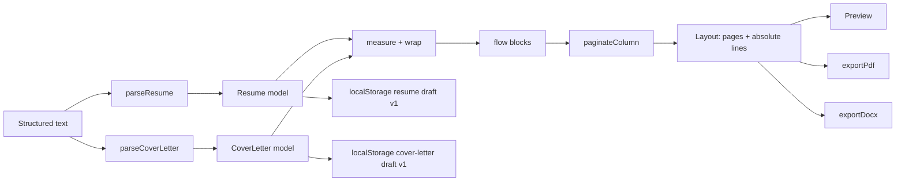

# Architecture

OpenResume is a client-only React application. Its correctness lives in a pure, testable pipeline that runs before anything touches the DOM.

## Invariants

1. **One layout, three consumers.** The preview, PDF, and DOCX all render from the same `Layout` produced by `layoutResume` or `layoutCoverLetter`. No exporter re-computes pagination.
2. **Points are the unit.** Page geometry, typography, and coordinates are expressed in PostScript points. CSS renders the same numbers with `pt` units; jsPDF consumes them directly.
3. **Content is preserved.** Both parsers never rewrite, summarize, or normalize user text beyond structural whitespace. Only explicit edits change content.
4. **Preparation replaces, never merges.** A new document fully replaces that document's model; concatenated documents are rejected.
5. **Document-selection first, never fabricated.** The landing page lets the user choose a resume or cover letter. Saved drafts are continued; no sample document is invented.
6. **No hidden I/O.** There are no runtime network calls, no server, and no telemetry. The only persistence is `localStorage`.
7. **Exports contain real text and identical content.** Pages are never rasterized. PDF text is selectable; DOCX paragraphs are editable; both carry every content string.
8. **Interface theme never touches the document.** Light/dark tokens style the shell only. The resume and cover letter pages and exports keep fixed colors.
9. **Independent documents.** Resume and cover letter drafts live under separate storage keys and can use different formatting. Building one never changes the other.
10. **AI instructions cannot drift.** Templates are generated from parser constants and tested against every alias.

## Pipeline

## Modules

| Module                                             | Responsibility                                       | Must not                     |
| -------------------------------------------------- | ---------------------------------------------------- | ---------------------------- |
| `src/components/LandingPage.tsx`                   | Document selection and saved-draft indicators        | Own document state           |
| `src/components/PrepareScreen.tsx`                 | Shared preparation, validation, AI copy, examples    | Parse with a wrong parser    |
| `src/components/Header.tsx`                        | Brand, context actions, status, theme slot           | Own document state           |
| `src/components/ThemeProvider.tsx`                 | Resolve and persist light/dark theme                 | Affect document colors       |
| `src/lib/theme.ts`                                 | Theme context, key, and system detection             | Render UI                    |
| `src/components/Footer.tsx`                        | Kovina attribution, links, and version               | Invent branding              |
| `src/lib/appMeta.ts`                               | Build-time application version                       | Read the network             |
| `src/lib/parse.ts`                                 | Deterministic text → `Resume`; warnings, no throwing | Know about React or layout   |
| `src/lib/parseCoverLetter.ts`                      | Deterministic text → `CoverLetter`; warnings         | Know about React or layout   |
| `src/lib/aiInstructions.ts`                        | Parser-generated AI instruction templates            | Duplicate parser rules       |
| `src/lib/coverLetterLayout.ts`                     | Single-column letter layout and pagination           | Recalculate resume layout    |
| `src/lib/coverLetterEdits.ts`                      | Pure cover letter edit helpers                       | Mutate inputs                |
| `src/lib/coverLetterScaffold.ts`                   | Reuse resume identity in a letter scaffold           | Generate letter body content |
| `src/lib/serialize.ts`                             | `Resume` → canonical input text (round-trip)         | Lose information             |
| `src/lib/normalize.ts`                             | Upgrade legacy templates and reject invalid presets  | Invent unsupported values    |
| `src/lib/metrics.ts`                               | Presets → page geometry, typography, and spacing     | Read the DOM                 |
| `src/lib/measure.ts`                               | Helvetica AFM metrics and greedy word wrap           | Depend on the DOM            |
| `src/lib/paginate.ts`                              | Flow blocks → pages at line boundaries               | Drop or duplicate lines      |
| `src/lib/layout.ts`                                | Resume flow blocks, header, page assembly            | Render or export             |
| `src/lib/content.ts`                               | Content strings for resume and letter parity checks  | Render or export             |
| `src/lib/exportPdf.ts`                             | Draw either `Layout` with jsPDF as selectable text   | Recalculate pagination       |
| `src/lib/exportDocx.ts`                            | Resume tables and single-column letter documents     | Rasterize or flatten text    |
| `src/lib/storage.ts`                               | Versioned, guarded drafts for both document types    | Throw on unavailable storage |
| `src/lib/resumeEdits.ts`                           | Pure immutable resume edit helpers                   | Mutate inputs                |
| `src/hooks/usePersistedDocument.ts`                | Generic debounced local draft persistence            | Know document shapes         |
| `src/hooks/useDraft.ts` / `useCoverLetterDraft.ts` | Typed document wrappers                              | Hold layout state            |
| `src/App.tsx`                                      | Landing/prepare/workspace state and both documents   | Contain layout logic         |

## Data model

`Resume` is the single source of truth (`src/types/resume.ts`):

- `header` — name and headline.
- `contact` — email, phone, location, and labeled links.
- `sections[]` — ordered sections with `kind`, `column` (`main`/`side`), `enabled`, and `items[]`.
- `items[]` — title, subtitle, date range, location, body, and bullets.
- `template` — page size, accent, and format settings (margins, font size, line/section/bullet/column spacing, density).

Section IDs and parser-created item IDs are deterministic, so repeated parses of the same text produce deep-equal models.

`CoverLetter` is the second document model (`src/types/coverLetter.ts`):

- `applicant` — name, optional headline, and contact.
- `date`, `recipient[]`, `position`, `salutation`, `closing`, `signature` — optional letter fields.
- `body[]` — ordered body paragraphs.
- `template` — the same page size, accent, and format shape as the resume.

Both models share `Contact`, `ResumeTemplate`, and `FormatSettings`, but have separate parsers, layouts, editors, and storage keys.

## Layout and pagination

- Page sizes: US Letter 612 × 792 pt (default), A4 595.28 × 841.89 pt, US Legal 612 × 1008 pt.
- `resolveMetrics()` turns the template into margins, content width, column widths, font sizes, line heights, and spacing, applying the density multiplier on top of individual spacing choices.
- Two independent columns share the content width (about 63% main, a configurable gap, the remainder side). The gap is reduced before the side column can fall below 100 pt.
- The header height is computed from the selected font metrics and the wrapped contact line; both columns start below it on page 1 and at the top margin thereafter.
- Text width is computed from embedded Helvetica AFM widths, which match the PDF's built-in font metrics. Wrapping is deterministic and independent of browser font rendering.
- Every flow block carries a semantic `kind` (`heading`, `title`, `subtitle`, `meta`, `body`, `bullet`, `listItem`, `skillLabel`, `skillValue`, plus `letterDate`, `recipient`, `subject`, `salutation`, `letterBody`, `closing`, `signature`) used by the DOCX exporter.
- `paginateColumn` places atomic blocks whole, splits paragraphs and bullet runs at line boundaries, and honours `keepWithNext` for headings, titles, subtitles, and metadata. A heading keeps with the first two lines of the next block.
- Page count is `max(mainPages, sidePages)`. Fully blank and trailing blank pages are removed.
- Cover letters use one full-width column. The letterhead is shared with the resume; blocks are date, recipient lines, subject, salutation, body paragraphs, closing, and signature. Closing keeps with signature, and salutation keeps with the first body paragraph. Empty optional blocks are skipped.

## Exports

**PDF.** jsPDF in `pt` units using the layout's page dimensions, Helvetica normal/bold, no compression, real text runs at the computed baselines. Page count always equals `Layout.pages.length`.

**DOCX.** For resumes, the `docx` package builds one no-border, three-column table per logical page (main, gap, side). For cover letters, it builds one full-width paragraph flow per logical page. Each flow block becomes one paragraph, so wrapped lines are rejoined and Word handles wrapping naturally. Bullets use Word numbering (resume only); headings, titles, metadata, letter closing/signature, and salutation use `keepNext`/`keepLines`; spacing derives from the same metrics. Page size, margins, and table widths follow the selected settings. Text remains editable, though Word may re-flow within a page after edits.

Both exporters are loaded with dynamic `import()` so the initial bundle stays small.

## Content integrity

- Preparation surfaces start empty; a new document cannot append to the previous one.
- `parseResume` and `parseCoverLetter` return `documentCount`. Text with more than one top-level `#` heading is rejected before it can replace the document.
- Building replaces only the selected document's model and preserves its current template (page size and formatting). The other document is untouched.
- Replacement requires explicit confirmation when a draft already exists.
- `collectContentStrings()` and `collectCoverLetterContentStrings()` extract every field from their models and are used to assert PDF/DOCX parity.
- The AI instruction templates are generated from parser alias constants and covered by drift tests.

## Views and workflow

`App` owns a three-value view state and an active document kind:

| View        | When                                      | Content                                              |
| ----------- | ----------------------------------------- | ---------------------------------------------------- |
| `landing`   | App start, Home, or no active document    | `LandingPage` with Build Resume / Build Cover Letter |
| `prepare`   | New, Import-like replacement, or no draft | `PrepareScreen` for the active kind                  |
| `workspace` | An active draft exists                    | Resume or cover letter editor and live preview       |

- `useDraft` and `useCoverLetterDraft` each return a nullable document. Neither fabricates a sample.
- The landing option opens the workspace when a draft exists, otherwise preparation.
- `PrepareScreen` requires exactly one top-level `#` heading and validates the selected parser's required fields. Zero or multiple headings produce a clear error and no state change.
- A successful build replaces that model, preserves its template (or reuses the resume template for a first cover letter), and switches to the workspace.
- New returns to preparation without discarding the draft; Back returns to the previous workspace or landing.
- The header hides document actions outside the workspace, showing only branding and the theme toggle.
- A matching-letter flow opens cover letter preparation with resume identity/contact prefilled and a return path to the resume. The resume is never modified.

## Theming

- `data-theme="light|dark"` on `<html>`; `color-scheme` follows it.
- Key `openresume-theme` stores an explicit choice.
- With no stored choice, the system preference is used and live `prefers-color-scheme` changes apply.
- An inline script in `index.html` resolves the theme before the stylesheet loads, preventing a flash.
- Tokens in `src/styles/tokens.css` follow the OpenPalette naming convention (`--bg-base`, `--bg-surface`, `--text-primary`, `--border-default`, `--accent`).
- The resume and cover letter pages, PDF, and DOCX use `COLORS` and fixed values in `preview.css`; they are never derived from UI theme tokens.
- Header icons are inline SVGs in `Icon.tsx`, avoiding a new runtime dependency.

## State and persistence

- `usePersistedDocument` provides debounced save, visibility flush, and save state; `useDraft` and `useCoverLetterDraft` wrap it for typed documents.
- Resume drafts use `openresume:draft.v1`; cover letter drafts use `openresume:cover-letter.v1`. Both are versioned and structurally validated (`isResume`, `isCoverLetter`). Corrupt payloads are ignored.
- Saves are debounced by 400 ms and flushed on `visibilitychange`; nothing is saved while a document is null.
- Formatting lives in each document's `template`, so it persists with that draft and survives replacement builds.
- Legacy resume drafts are normalized with defaults, including `paragraphSpacing`.
- Theme persistence is independent (`openresume-theme`), so content changes never change the interface theme.

## Dependency policy

Runtime dependencies are limited to:

- `react`, `react-dom` — UI.
- `jspdf` — text-based PDF generation.
- `docx` — editable document generation.

No state library, router, CSS framework, parser library, or storage wrapper. Add a dependency only when it removes more code than it introduces and does not compromise the invariants above.

## Testing

- Parser, serializer, measurement, pagination, layout, edits, storage, and exports have focused unit tests for both document types.
- The long-resume and long-letter tests assert every bullet or paragraph appears exactly once across pages.
- Export tests assert `%PDF`, page count, real text presence, ZIP magic bytes, text inclusion, and resume/letter single-vs-two-column structure.
- AI instruction tests assert every parser alias appears in the matching template and that the bundled examples parse.
- Component tests cover landing navigation, preparation validation, editing, section toggling, formatting visibility, copy feedback, examples, independent persistence, matching-letter reuse, confirmation, migration, and theme persistence.

## Extension points

- **Page size.** Add a preset in `metrics.ts`; both layouts consume the resolved metrics.
- **Templates.** Introduce a template profile that supplies metrics, column ratios, and section defaults; do not fork the pipeline.
- **Fonts.** Replace the embedded width tables with a font embedded in both the browser and the PDF, keeping measurement and rendering identical.
- **Document types.** Add a third model by following the cover letter pattern: parser, layout, editor, exports, storage key, and preparation validation.

## Non-goals for v0.1.3

Multi-user accounts, cloud sync, AI content generation, PDF/DOCX import, and multi-template galleries.
