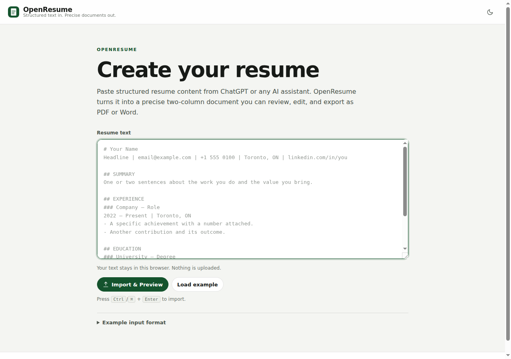
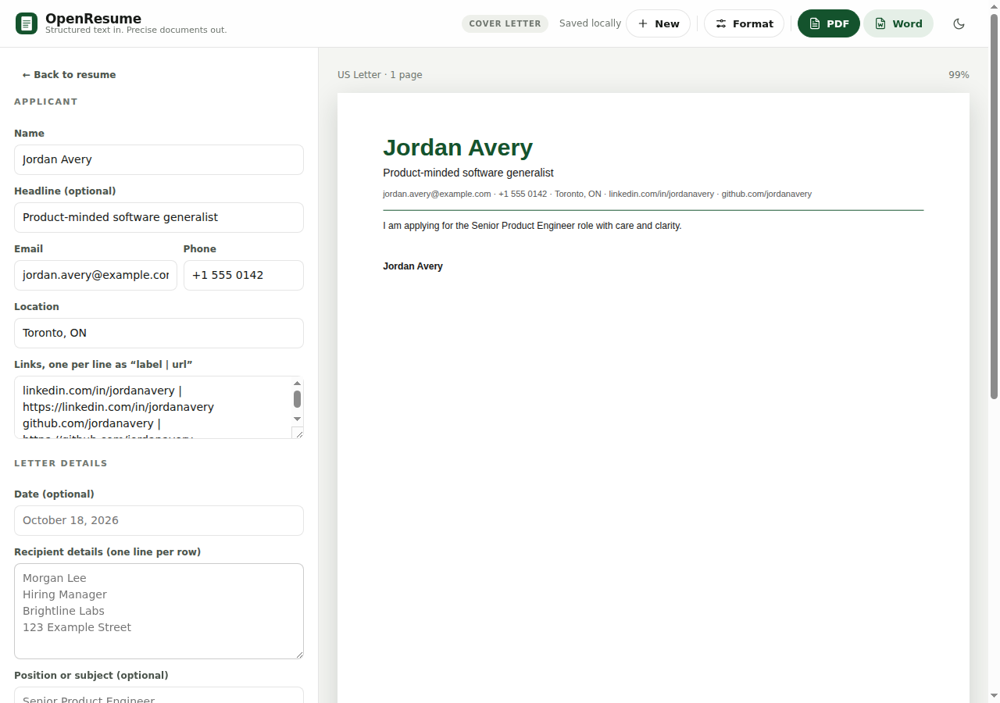
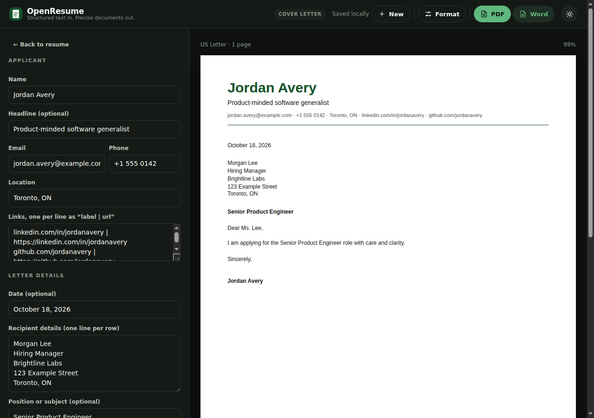

# OpenResume

<p align="center">
  <picture>
    <source media="(prefers-color-scheme: dark)" srcset="assets/app-icon/dark/icon-192.png">
    
  </picture>
</p>

A privacy-first, local-first resume and cover letter builder that turns structured text into precise PDF and DOCX documents.

## Status

**Early development — v0.1.6.** Built for a single-user, fast-repetition workflow first; the architecture leaves room for broader public use later.

**Live:** https://resume.kovina.org (production, v0.1.5; the v0.1.6 branding update is committed locally pending publication). The original Vercel deployment remains available at https://openresume-sigma.vercel.app.

## Description

OpenResume exists because document updates should not require an account, a subscription, or a web service that keeps a copy of your career history. You paste structured text — the kind ChatGPT or an AI assistant already produces — and OpenResume deterministically parses it into a precise resume or cover letter.

Resumes use a fixed two-column layout. Cover letters use a calm single-column business-letter layout. Both support live preview, formatting, reliable pagination, selectable-text PDF export, and editable DOCX export.

Everything runs in the browser. There is no backend, authentication, analytics, cloud storage, or integrated AI. Documents live in memory for the current session only; exports are generated locally. The app never makes a network request at runtime.

The workflow is:

```
Choose document → Prepare content → Build → Edit/Preview → Export
```

OpenResume opens on a document-selection screen with two cards: **Resume** and **Cover Letter**. Each card starts a new build in its preparation screen. A document created in the current session can be reopened from its card with **Open resume** or **Open cover letter**.



Documents are session-only. Reloading or closing the page may discard them; nothing is written to `localStorage` except the interface theme. A new build replaces the previous document of the same type without a confirmation dialog.

## Features

- **Two-card document-selection landing page** for a resume or a cover letter, with Build and session-only Open actions.
- **Preparation screens** with a large paste area, Copy AI Instructions, Load Example, and inline validation.
- **Deterministic parsing** — no model calls, no guessing, no content rewriting.
- **Resume workspace** preserving the fixed two-column template, section ordering, editing, and pagination.
- **Cover letter workspace** with applicant details, date, recipient, position, salutation, body paragraphs, closing, and signature.
- **Create matching cover letter** from a resume, reusing applicant identity and contact details without changing the resume.
- **AI instruction templates** for both document types, generated from the parsers' supported headings and covered by drift tests.
- **Session-based documents** for resumes and cover letters; navigating within the app preserves both, while reloads start clean.
- **US Letter, A4, and US Legal** page sizes, switchable before export.
- **Document-specific formatting controls** for margins, font size, line spacing, section spacing, content density, and the controls relevant to each document type.
- **Live, page-aware preview** rendered from the same layout coordinates as the exports.
- **Reliable pagination** that keeps headings and signatures with content and avoids blank pages.
- **Selectable-text PDF** generated with real text, not screenshots.
- **Editable DOCX** with readable, naturally flowing paragraphs.
- **Light, dark, and system themes** with a persistent, flash-free header toggle.
- **Accessible editors** with labeled controls, keyboard focus, and reduced-motion support.
- **Theme-aware branding** with light and dark app icons, favicons, and social preview assets generated from the authoritative logo masters.
- **No backend, auth, analytics, cloud storage, or AI.**

## Cover letters

The cover letter workspace uses a single-column business-letter layout:

- Applicant name, optional headline, and contact information.
- Date, recipient details, position or subject, and salutation.
- Multiple editable body paragraphs.
- Closing and signature.
- The same page sizes, margins, font sizing, line spacing, section spacing, paragraph spacing, and content density as the resume.
- Selectable-text PDF and editable DOCX exports.

The resume template is unchanged. Formatting is stored with each document, so the two documents can use different settings.



## AI instructions

Both preparation screens include **Copy AI Instructions**. The copied template explains the exact structured format, supported headings and aliases, entry/paragraph rules, optional fields, and the factual-accuracy requirement. Paste it into ChatGPT, Claude, or another assistant, provide your details, and paste the result back into OpenResume.

The templates live beside the parsers in `src/lib/aiInstructions.ts` and are generated from the parsers' supported headings. Tests fail if an alias exists in a parser but not in the instructions. See [docs/ai-instructions.md](docs/ai-instructions.md).

## Themes

The header toggle switches between light and dark. With no stored choice, OpenResume follows the operating system preference and updates live when it changes. The choice persists under `openresume-theme`.

The interface shell changes theme; **the resume and cover letter documents and their PDF/DOCX colors do not**. The preview page always keeps its professional white page and fixed typography colors.



## Architecture

See [ARCHITECTURE.md](ARCHITECTURE.md) for the pipeline, module boundaries, invariants, and pagination model.

The short version:

```
structured text → parser → document model → layout engine → pages
                                                          ├── live preview
                                                          ├── PDF (jsPDF)
                                                          └── DOCX (docx)
```

Resume and cover letter models share contact parsing, metrics, pagination, preview components, and export primitives while keeping separate templates and layouts.

## Deployment

**Production:** https://resume.kovina.org

The original Vercel deployment address is retained at https://openresume-sigma.vercel.app.

Vercel builds the standard Vite output (`npm run build` → `dist`) from `main` with no environment variables. Pull requests receive preview deployments, and the production domain is public. HTTP requests are redirected to HTTPS automatically by Vercel with a `308`. See [docs/deployment.md](docs/deployment.md) for configuration, headers, caching, and verification.

## Branding

The application icon is generated from the authoritative light and dark PNG masters in [`assets/branding/source-assets`](assets/branding/source-assets/). The reproducible pipeline and complete asset inventory are documented in [docs/branding.md](docs/branding.md).

## Getting started

```bash
git clone https://github.com/sparshsam/openresume
cd openresume
npm ci
npm run dev
```

Open the printed local URL. The app opens on the document-selection screen. Choose a document, then use **Load Example** on the preparation screen to start with a fictional sample.

### Commands

| Command                | Purpose                            |
| ---------------------- | ---------------------------------- |
| `npm run dev`          | Start the Vite development server  |
| `npm run build`        | Typecheck and produce `dist/`      |
| `npm run preview`      | Serve the production build locally |
| `npm run lint`         | ESLint                             |
| `npm run format:check` | Prettier check                     |
| `npm run typecheck`    | TypeScript, no emit                |
| `npm test`             | Vitest suite                       |
| `npm run check`        | Lint, typecheck, test, and build   |

Helper scripts live in `scripts/` (`build.sh`, `test.sh`, `lint.sh`, `generate-icons.py`), each with `--help`.

### Keyboard

- `Ctrl`/`⌘` + `Enter` builds from the preparation screen.
- `Escape` returns to the previous workspace or the landing page.
- All header actions are native buttons with focus-visible rings and accessible labels.

## Input format

The canonical formats and edge cases for both documents are documented in [docs/input-format.md](docs/input-format.md).

A minimal resume example:

```text
# Jordan Avery
Product-minded software generalist | jordan@example.com | +1 555 0142 | Toronto, ON

## SUMMARY
One or two sentences of positioning.

## EXPERIENCE
### Northwind Studio — Senior Product Engineer
2022 – Present | Toronto, ON
- Shipped a thing that mattered, with a number attached.
```

A minimal cover letter example:

```text
# Jordan Avery
Product-minded software generalist | jordan@example.com | Toronto, ON

## DATE
October 18, 2026

## RECIPIENT
Morgan Lee
Hiring Manager
Brightline Labs

## POSITION
Senior Product Engineer

## SALUTATION
Dear Ms. Lee,

## BODY
First paragraph.

Second paragraph.

## CLOSING
Sincerely,

## SIGNATURE
Jordan Avery
```

Parsing is deterministic: markers define structure, and content is preserved exactly except for structural whitespace. Prepare one document at a time; text containing more than one top-level `#` heading is rejected so documents cannot be mixed.

## Page sizes and formatting

The default is **US Letter (8.5 × 11 in)**. The **Formatting** panel also offers A4 (210 × 297 mm) and US Legal (8.5 × 14 in), plus:

| Control           | Options                     | Shown for    |
| ----------------- | --------------------------- | ------------ |
| Page margins      | Narrow, Normal, Wide        | Both         |
| Font size         | Small, Standard, Large      | Both         |
| Line spacing      | Compact, Standard, Relaxed  | Both         |
| Section spacing   | Compact, Standard, Relaxed  | Both         |
| Paragraph spacing | Compact, Standard, Relaxed  | Cover letter |
| Bullet spacing    | Compact, Standard, Relaxed  | Resume       |
| Column spacing    | Narrow, Standard, Wide      | Resume       |
| Content density   | Compact, Balanced, Spacious | Both         |

Formatting applies to the preview, PDF, and DOCX, and stays with each document for the current session. **Reset to defaults** restores US Letter with the standard presets. See [docs/formatting.md](docs/formatting.md).

## Limitations

- One fixed two-column resume template and one fixed single-column letter template; page sizes and spacing are configurable.
- Helvetica-family metrics only; custom font embedding is not supported.
- DOCX flows text naturally inside each logical page. Editing in Word can re-flow individual pages; pagination is structurally consistent with the PDF rather than pixel-identical.
- No import from PDF or existing DOCX; input is structured text only.
- Cover letters are not generated. **Create matching cover letter** reuses identity and contact details and scaffolds the section markers; you write the body.
- No cloud sync, backup, or reload recovery. Reloading or closing the page discards the current documents.
- Desktop-first. Editing works on smaller screens but is not the primary workflow.
- The app icon is an intentional placeholder and will be replaced.

## Privacy model

No network requests, no telemetry, no accounts. Resume and cover letter content stays in memory for the current session and is never written to `localStorage`. Only the interface theme preference is stored, under `openresume-theme`. See [docs/privacy-model.md](docs/privacy-model.md).

## Ecosystem role

OpenResume is part of the [Kovina](https://kovina.org) ecosystem of owned, local-first tools. It follows shared Kovina ecosystem standards and the public [Kovina standards](https://github.com/sparshsam/kovina/tree/main/standards) where they do not conflict.

## License

[MIT](LICENSE).

<br>

---

<br>

<p align="center">
  <strong>Part of the Kovina Collection</strong>
</p>

<p align="center">
  <a href="https://github.com/sparshsam/openreader">OpenReader</a> ·
  <a href="https://github.com/sparshsam/openjournal">OpenJournal</a> ·
  <a href="https://github.com/sparshsam/openledger">OpenLedger</a> ·
  <a href="https://github.com/sparshsam/opentone">OpenTone</a> ·
  <a href="https://github.com/sparshsam/openpalette">OpenPalette</a> ·
  <a href="https://github.com/sparshsam/openconvert">OpenConvert</a>
</p>

<p align="center">
  <a href="https://github.com/sparshsam/opensnap">OpenSnap</a> ·
  <a href="https://github.com/sparshsam/worldclock-widget">WorldClock Widget</a> ·
  <a href="https://github.com/sparshsam/openproof">OpenProof</a> ·
  <a href="https://github.com/sparshsam/opensend">OpenSend</a> ·
  <a href="https://github.com/sparshsam/opensprout">OpenSprout</a>
</p>

<p align="center">
  <a href="https://github.com/sparshsam/wordwise">WordWise</a> ·
  <a href="https://github.com/sparshsam/openscrabble">OpenScrabble</a> ·
  <a href="https://github.com/sparshsam/chess-by-sparsh">Chess by Sparsh</a> ·
  <a href="https://github.com/sparshsam/hisstastic">Hisstastic</a>
</p>

<p align="center">
  <sub>Minimal, focused tools for everyday tasks.</sub>
</p>

---

_This repository follows the shared Kovina ecosystem standards._
