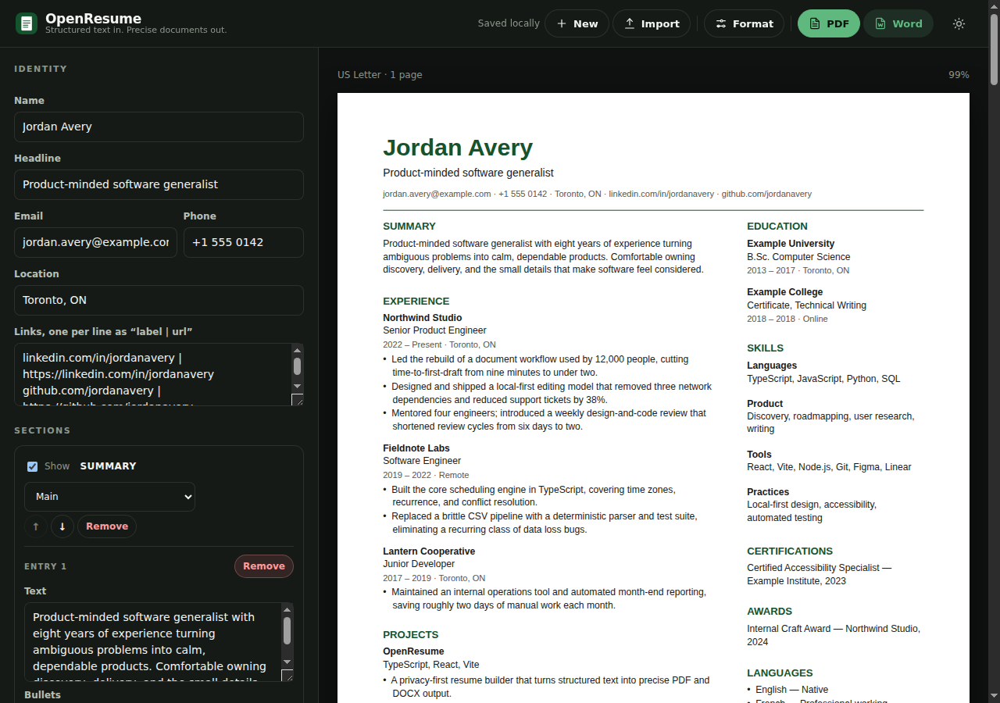

# OpenResume

A privacy-first, local-first resume builder that turns structured text into professionally formatted PDF and DOCX resumes.

## Status

**Early development — v0.1.2.** Built for a single-user, fast-repetition workflow first; the architecture leaves room for broader public use later.

**Live:** https://openresume-sigma.vercel.app

## Description

OpenResume exists because resume updates should not require an account, a subscription, or a web service that keeps a copy of your career history. You paste structured text — the kind ChatGPT or an AI assistant already produces — and OpenResume deterministically parses it into a fixed, two-column document with reliable pagination.

Everything runs in the browser. There is no backend, authentication, analytics, cloud storage, or integrated AI. Drafts are stored in `localStorage`; exports are generated locally. The app never makes a network request at runtime.

The workflow is deliberately import-first:

```
Paste AI-generated resume text → Import → Review → Export
```

No draft yet? OpenResume opens on a focused import screen. A saved draft opens directly in the editor, with **New** and **Import** always available.


## Features

- **Import-first experience** with a large paste area, example input, and inline validation.
- **Structured text input** with predefined and custom sections.
- **Deterministic parsing** — no model calls, no guessing, no content rewriting.
- **Fixed two-column template** with configurable section ordering and column assignment.
- **US Letter, A4, and US Legal** page sizes, switchable before export.
- **Formatting controls** for margins, font size, line, section, bullet, and column spacing, plus content density.
- **Clean replacement imports** that reject concatenated resumes instead of merging them.
- **Live, page-aware preview** rendered from the same layout coordinates as the exports.
- **Reliable pagination** that keeps headings with content, never drops a line, and avoids blank pages.
- **Selectable-text PDF** generated with real text, not screenshots.
- **Editable DOCX** with readable, naturally flowing paragraphs and real Word bullets.
- **Local draft and formatting persistence** with a versioned storage key.
- **Light, dark, and system themes** with a persistent, flash-free header toggle.
- **Icon-led header actions** — New, Import, Format, PDF, and Word.
- **Accessible editor** with labeled controls, keyboard focus, and reduced-motion support.
- **No backend, auth, analytics, cloud storage, or AI.**

## Themes

The header toggle switches between light and dark. With no stored choice, OpenResume follows the operating system preference and updates live when it changes. The choice persists under `openresume-theme`.

The interface shell changes theme; **the resume document and its PDF/DOCX colors do not**. The preview page always keeps its professional white page and fixed typography colors.



## Architecture

See [ARCHITECTURE.md](ARCHITECTURE.md) for the pipeline, module boundaries, invariants, and pagination model.

The short version:

```
structured text → parser → Resume model → layout engine → pages
                                                     ├── live preview
                                                     ├── PDF (jsPDF)
                                                     └── DOCX (docx)
```

## Deployment

**Production:** https://openresume-sigma.vercel.app

Vercel builds the standard Vite output (`npm run build` → `dist`) from `main` with no environment variables. Pull requests receive preview deployments, and the production domain is public. See [docs/deployment.md](docs/deployment.md) for configuration, headers, caching, and verification.

## Getting started

```bash
git clone https://github.com/sparshsam/openresume
cd openresume
npm ci
npm run dev
```

Open the printed local URL. With no saved draft, the app opens the import screen; **Load example** fills it with a fictional sample.

### Commands

| Command                | Purpose                            |
| ---------------------- | ---------------------------------- |
| `npm run dev`          | Start the Vite development server  |
| `npm run build`        | Typecheck and produce `dist/`      |
| `npm run preview`      | Serve the production build locally |
| `npm run lint`         | ESLint                             |
| `npm run format:check` | Prettier check                     |
| `npm run typecheck`    | TypeScript, no emit                |
| `npm test`             | Vitest suite                       |
| `npm run check`        | Lint, typecheck, test, and build   |

Helper scripts live in `scripts/` (`build.sh`, `test.sh`, `lint.sh`, `generate-icons.py`), each with `--help`.

### Keyboard

- `Ctrl`/`⌘` + `Enter` imports from the import screen.
- `Escape` returns to the current resume from the New/Import screen.
- All header actions are native buttons with focus-visible rings and accessible labels.

## Input format

The canonical format and edge cases are documented in [docs/input-format.md](docs/input-format.md). A minimal example:

```text
# Jordan Avery
Product-minded software generalist | jordan@example.com | +1 555 0142 | Toronto, ON

## SUMMARY
One or two sentences of positioning.

## EXPERIENCE
### Northwind Studio — Senior Product Engineer
2022 – Present | Toronto, ON
- Shipped a thing that mattered, with a number attached.
```

Parsing is deterministic: markers define structure, and content is preserved exactly except for structural whitespace. Import one resume at a time; text containing more than one top-level `#` heading is rejected so documents cannot be mixed.

## Page sizes and formatting

The default is **US Letter (8.5 × 11 in)**. The **Formatting** panel also offers A4 (210 × 297 mm) and US Legal (8.5 × 14 in), plus:

| Control         | Options                     |
| --------------- | --------------------------- |
| Page margins    | Narrow, Normal, Wide        |
| Font size       | Small, Standard, Large      |
| Line spacing    | Compact, Standard, Relaxed  |
| Section spacing | Compact, Standard, Relaxed  |
| Bullet spacing  | Compact, Standard, Relaxed  |
| Column spacing  | Narrow, Standard, Wide      |
| Content density | Compact, Balanced, Spacious |

Formatting applies to the preview, PDF, and DOCX, and is saved with the local draft. **Reset to defaults** restores US Letter with the standard presets. See [docs/formatting.md](docs/formatting.md).

## Limitations

- One fixed two-column template; page sizes and spacing are configurable.
- Helvetica-family metrics only; custom font embedding is not supported.
- DOCX flows text naturally inside each logical page. Editing in Word can re-flow individual pages; pagination is structurally consistent with the PDF rather than pixel-identical.
- No import from PDF or existing DOCX; input is structured text only.
- No cloud sync or backup. Clearing browser storage deletes the draft.
- Desktop-first. Editing works on smaller screens but is not the primary workflow.
- The app icon is an intentional placeholder and will be replaced.

## Privacy model

No network requests, no telemetry, no accounts. Drafts live under `openresume:draft.v1` in the browser's `localStorage`. See [docs/privacy-model.md](docs/privacy-model.md).

## Ecosystem role

OpenResume is part of the [Kovina](https://kovina.org) ecosystem of owned, local-first tools. It follows the [ecosystem standards](https://github.com/sparshsam/ecosystem-standards) and the [Kovina standards](https://github.com/sparshsam/kovina/tree/main/standards) where they do not conflict.

## License

[MIT](LICENSE).

<br>

---

<br>

<p align="center">
  <strong>Part of the Kovina Collection</strong>
</p>

<p align="center">
  <a href="https://github.com/sparshsam/openreader">OpenReader</a> ·
  <a href="https://github.com/sparshsam/openjournal">OpenJournal</a> ·
  <a href="https://github.com/sparshsam/openledger">OpenLedger</a> ·
  <a href="https://github.com/sparshsam/opentone">OpenTone</a> ·
  <a href="https://github.com/sparshsam/openpalette">OpenPalette</a> ·
  <a href="https://github.com/sparshsam/openconvert">OpenConvert</a>
</p>

<p align="center">
  <a href="https://github.com/sparshsam/opensnap">OpenSnap</a> ·
  <a href="https://github.com/sparshsam/worldclock-widget">WorldClock Widget</a> ·
  <a href="https://github.com/sparshsam/openproof">OpenProof</a> ·
  <a href="https://github.com/sparshsam/opensend">OpenSend</a> ·
  <a href="https://github.com/sparshsam/opensprout">OpenSprout</a>
</p>

<p align="center">
  <a href="https://github.com/sparshsam/wordwise">WordWise</a> ·
  <a href="https://github.com/sparshsam/openscrabble">OpenScrabble</a> ·
  <a href="https://github.com/sparshsam/chess-by-sparsh">Chess by Sparsh</a> ·
  <a href="https://github.com/sparshsam/hisstastic">Hisstastic</a>
</p>

<p align="center">
  <sub>Minimal, focused tools for everyday tasks.</sub>
</p>

---

_This repository follows the [ecosystem standards](https://github.com/sparshsam/ecosystem-standards)._
